# Microgrid Dispatch (Wind, Solar, Energy Storage, Interaction with the Grid) (Matlab & Python Code Implementation)

​  
Numerous scholars have conducted extensive research on this topic. Considering the correlation between electricity prices and load response volume. Established the lowest operating cost The model with the highest renewable energy consumption ratio and the best user satisfaction as its objective is the day-ahead dispatch model. In response to the issue of uncertainties in the output of new energy in microgrids, From the perspective of grid-connected microgrid operators, a two-stage day-ahead optimization scheduling framework for supply and demand coordination is proposed to reduce system operational costs and risks. Considering the uncertainty of wind power and the intermittency of renewable energy, A method of day-ahead stochastic optimization dispatch for microgrid considering risk is proposed. The objective can also be to minimize operational costs. Considering energy storage at the same time. A model of day-ahead dispatch for microgrids is proposed.
2 Microgrid Model The microgrid model discussed in this paper includes: wind turbines, photovoltaic solar panels, grid power tie lines, diesel generators, energy storage batteries, and electrical load.
3. Economic Dispatch Mathematical Model of Microgrid
The charge state of the battery should meet the upper and lower limit constraints. At the same time, the power of charging and discharging for a battery also has upper and lower limits. Microgrids and main grid power exchange have constraints. The scenery can be discarded. In this case: The objective function is seen in the formula:
4. Matlab & Python Code Implementation
Matlab:  
%% Wind, solar, and time-of-use electricity price data\n%==========================24-hour load data===========================\nLoad=[88.24 \t83.01 \t80.15 \t79.01 \t76.07 \t78.39 \t89.95 \t128.85 \t155.45 \t176.35 \t193.71 \t182.57 \t179.64 \t166.31 \t164.61 \t164.61 \t174.48 \t203.93 \t218.99 \t238.11 \t216.14 \t173.87 \t131.07 \t94.04];\n\n%============================Wind Turbine Predicted Power==========================\nPw=[66.9\t68.2\t71.9\t72\t78.8\t94.8\t114.3\t145.1\t155.5\t142.1\t115.9\t127.1\t141.8\t145.6...\n    145.3\t150\t206.9\t225.5\t236.1\t210.8\t198.6\t177.9\t147.2\t58.7];\n\n%============Photovoltaic Power Forecasting===============\nPpv=[0\t0\t0\t0\t0.06\t6.54\t20.19\t39.61\t49.64\t88.62\t101.59\t66.78\t110.46\t67.41\t31.53...\n    50.76\t20.6\t22.08\t2.07\t0\t0\t0\t0\t0];\n\n%=======================Time-of-Use Electricity Price==========\nC_buy=[0.25\t0.25\t0.25\t0.25\t0.25\t0.25\t0.25\t0.53\t0.53\t0.53\t0.82\t0.82...\n    0.82\t0.82\t0.82\t0.53\t0.53\t0.53\t0.82\t0.82\t0.82\t0.53\t0.53\t0.53];\nC_sell=[0.22\t0.22\t0.22\t0.22\t0.22\t0.22\t0.22\t0.42\t0.42\t0.42\t0.65\t0.65...\n    0.65\t0.65\t0.65\t0.42\t0.42\t0.42\t0.65\t0.65\t0.65\t0.42\t0.42\t0.42];\n\n  
Python code:
print('Total cost',np.array(shuju).sum()*0.25)\n\nplt.plot(file['LoadkW'],'b--',label='Load')\nplt.plot(np.array(PF),'r-',label='Wind turbine real-time power')\nplt.plot(np.array(PS),'g-.',label='Photovoltaic real-time power')\nplt.plot(np.array(PN),'c:',label='Exchange power with the main network')\nplt.plot(file['Real-time situation of the battery'],'yellowgreen',label='Battery power')\nplt.ylabel('P/kW')\nplt.xlabel('t/0.25h')\nplt.legend()\nplt.show()\n  
Editor
4.2 Editing Running Results
Editor
Editor
Editor
Editor
5 End Notes: Theoretical references are from online literature. If there is any infringement, please contact the blogger to delete it.

## Images

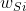
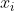
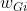
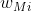
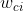
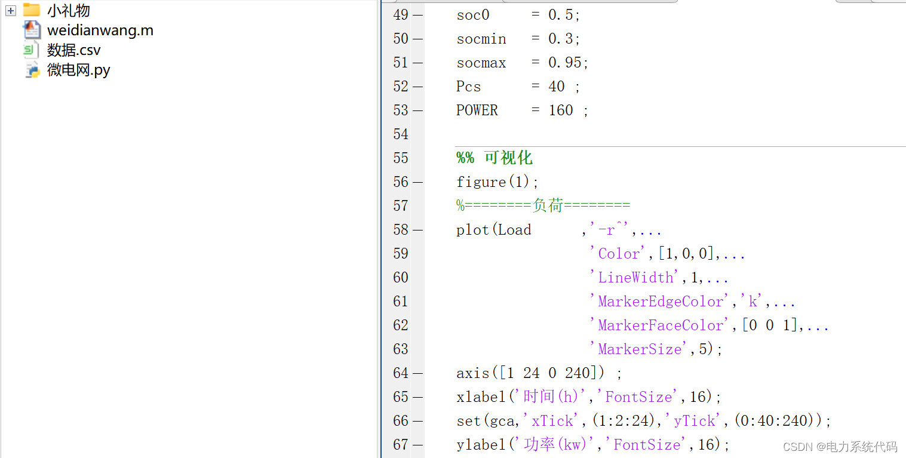
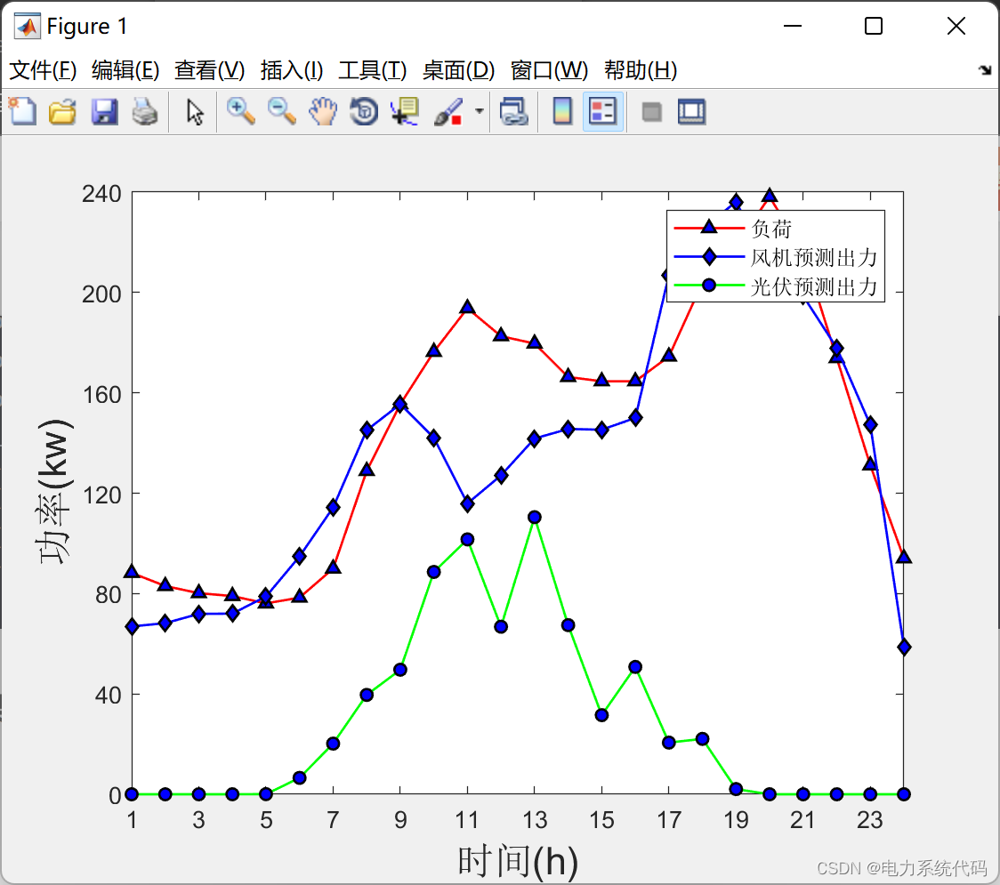
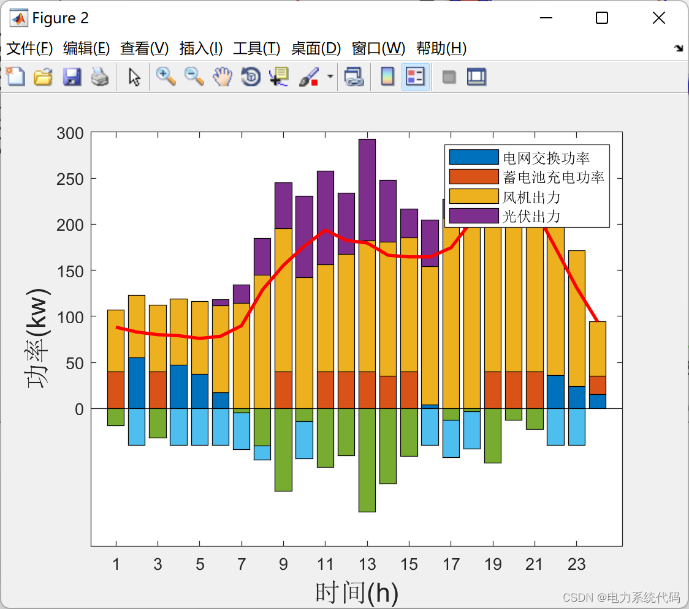
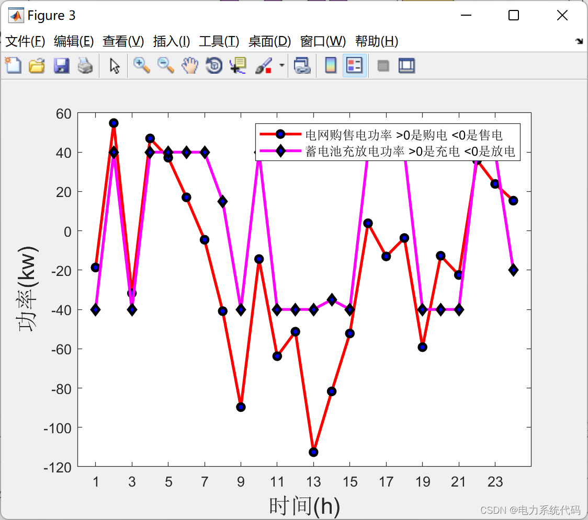
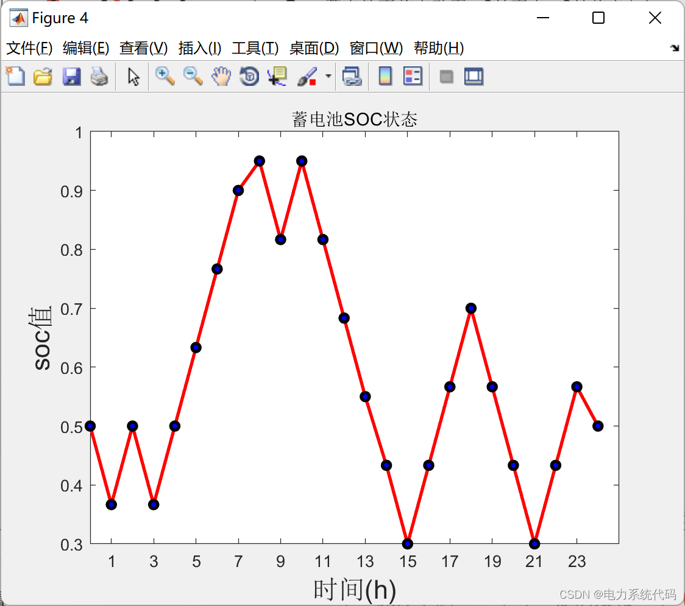
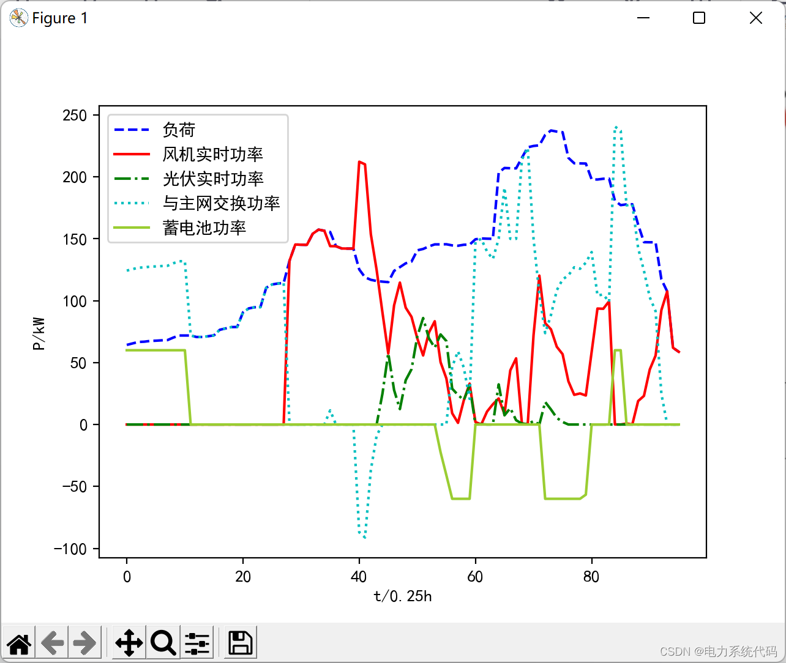

<!-- PAYMENT_BLOCK -->

## Get this dataset

- Payment link (Stripe): [Buy now](https://buy.stripe.com/3cs8yP7sY87d0vu9AB)
- Payment QR code: 

<!-- /PAYMENT_BLOCK -->
